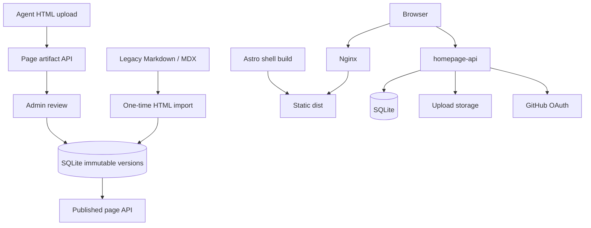

# HomePage 架构说明

## 系统边界

HomePage 由一个静态前端和一个独立 API 组成：

- Astro 输出站点外壳；主页和内容列表在运行时读取已发布页面 API。
- Nginx 在 `xgwnje.cn` 提供静态页面。
- 浏览器直接请求 `api.xgwnje.cn` 上的 Node.js API。
- API 使用 SQLite 保存结构化数据，并使用独立持久目录保存上传文件。

新内容底座以不可变 HTML 页面版本为一等内容：Agent 只能通过 API 上传灰度版本，管理员在审核台批准后，必须携带同一 SHA-256 才能发布。Markdown/Astro 文章管线在迁移期间仅用于旧内容，不再是新页面的创作入口。

共享服务器拓扑不在本仓库重复维护；真实 DNS、端口、Nginx 和 systemd 事实以本机 `D:\ObjectCode\Server-infra` 为准。

## 代码职责

| 位置 | 职责 |
| --- | --- |
| `src/content.config.ts` | 内容 schema |
| `src/content/blog/` | 历史双语文章源文件，仅用于迁移与回退 |
| `src/pages/` | Astro 路由 |
| `src/components/` | 页面组件和浏览器交互 |
| `src/layouts/BlogPost.astro` | 文章详情布局 |
| `src/data/` | 导航、链接、i18n 与语录数据 |
| `server/src/app.js` | HTTP 路由和应用逻辑 |
| `server/src/db.js` | SQLite schema、`user_version` 迁移与数据库适配 |
| `server/src/routes/pages.js` | Agent HTML 上传、轻量边界报告、版本审批与公开读取 |
| `server/src/config.js` | 环境变量解析与运行配置 |

## 数据流

### HTML 页面制品

1. Agent 使用独立 `PAGE_AGENT_TOKEN` 提交 `slug`、标题、摘要和完整 HTML。
2. API 校验输入，计算 SHA-256，并将脚本、内联事件、iframe、表单和外部 URL 记入轻量审核报告。
3. 新版本一律为 `draft`，不影响已发布版本。
4. 管理员先批准版本，再按已批准的 SHA-256 发布；撤回只清除公开指针，不删除历史版本。
5. 公开读取接口只返回 `published_version_id` 指向的版本；首页与内容列表运行时读取该接口，所以发布无需重建前端。
6. 公共阅读页通过无脚本 sandbox iframe 展示 HTML，避免页面内容获得主站执行权限。

轻量审核报告是管理员判断线索，不是 HTML sanitizer；任意 HTML 的生产隔离域、CSP 和 sandbox 仍属于上线前必须完成的部署边界。

### 历史内容迁移

1. `npm run build` 生成历史文章的完整 HTML。
2. `npm run content:import-legacy` 将未迁移文章幂等写入页面表，状态直接标记为已发布并记录 `legacy-import` 审核者。
3. 原 Markdown / MDX 文件不删除，作为迁移期回退来源；前台首页与内容列表不再读取它们。

### 登录与交互

1. 浏览器通过 GitHub OAuth 或邮箱登录请求 API。
2. API 将 session 保存到 SQLite，并把 session token 返回给前端。
3. 前端使用 Bearer token 请求用户、评论、上传和受保护接口。
4. 浏览量、评论、联系消息、outbox 与上传元数据保存在 SQLite。

## 当前决策

### VPS/Nginx 是唯一生产部署

当前生产前端始终以站点根路径构建并发布到 VPS，服务端配置由 `Server-infra` 管理。构建配置中的兼容目标不构成生产发布流程，也不在运行手册中维护平台专用步骤。

### 数据与代码 release 分离

后端代码使用版本化 release；SQLite、上传文件和运行环境配置独立持久化。切换或回滚代码 release 时不得覆盖数据目录。

### 旧文章静态发布通道已退居迁移兼容层

文章更新会同时改变首页、博客列表、标签、RSS 与 Sitemap，因此本地仍生成完整 `dist/`。`ContentOnly` 快速通道从线上 release manifest 取得生产代码 revision，并强制要求该 revision 到 HEAD 的全部变更只含普通 Markdown、`public/image/blog/` 图片和 `public/file/blog/` 安全附件；存在未上线代码改动时通道拒绝发布，提示升级到普通前端或完整审查。校验通过后在主工作区直接构建，与线上完整静态树生成差量，只上传变化的静态文件，在服务器重建完整版本并原子切换；它不部署 API、不修改 Nginx。

旧的 Markdown 发布脚本和后端路由暂时保留用于回滚与数据迁移，但后台不再提供编辑入口，新内容统一走 HTML 页面 API 与管理员审核台。

### 后台使用当前管理员会话

后台页面与管理 API 使用当前 Bearer session，不依赖 Cloudflare Access 注入头。权限边界必须同时满足：

1. 未登录和非管理员请求被拒绝。
2. 有效管理员可读取统计、评论、联系消息和 outbox，并执行审核操作。
3. API 自动测试与真实浏览器端到端验证都通过后，才可对外宣称后台完整可用。

### 图片 CDN 是条件能力

当前上传文件由 API 的 `/uploads` 路径提供。`img.xgwnje.cn` 不是已完成能力；只有 DNS、存储、迁移清单、缓存策略和回滚全部验证后才能启用。迁移外部文章时，在此之前保留原始图片 URL。

## 上游关系

前端来源是 [Dancncn/DansBlog](https://github.com/Dancncn/DansBlog)。`XGWNJE/DansBlogs_worker` 可用于理解上游 Worker 行为，但不能作为当前生产后端的事实来源。
